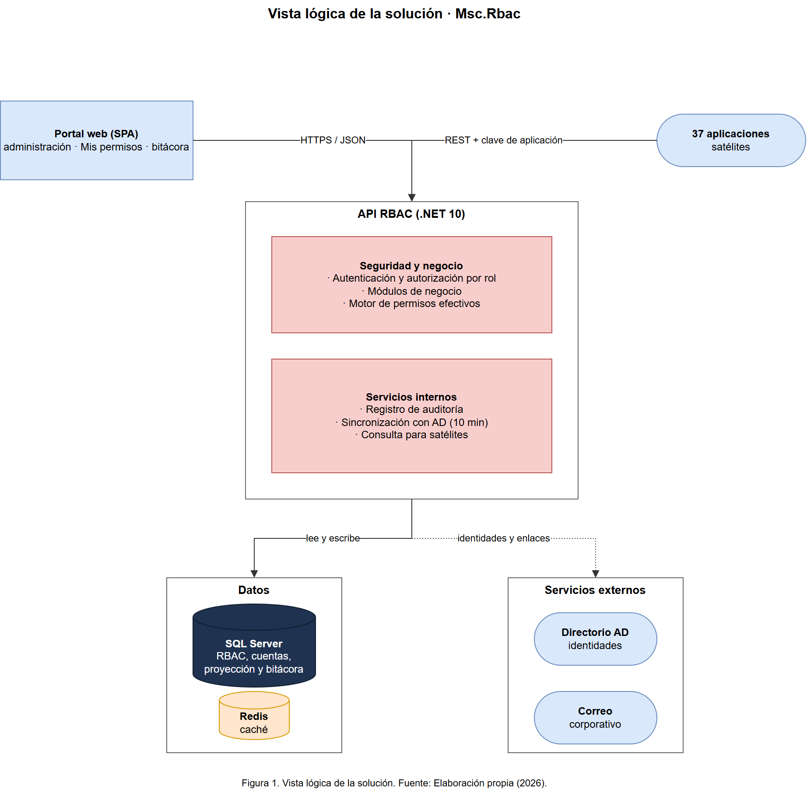
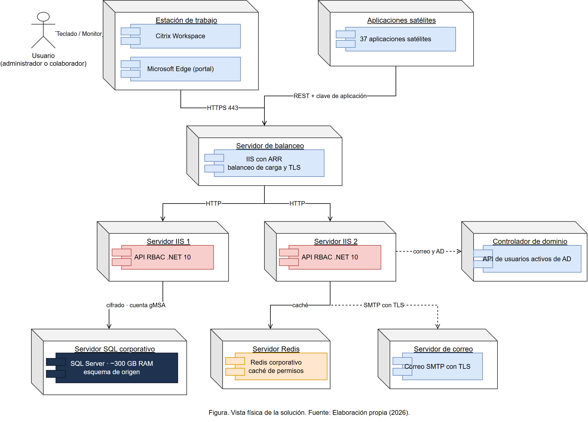
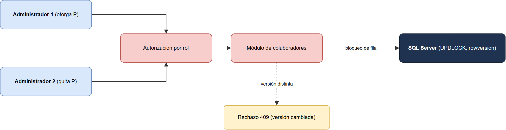
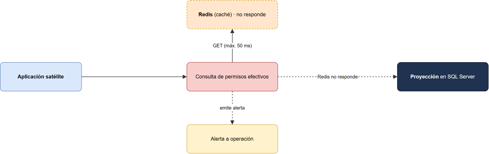
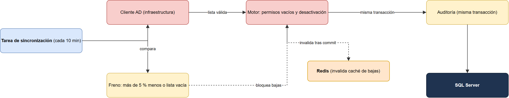
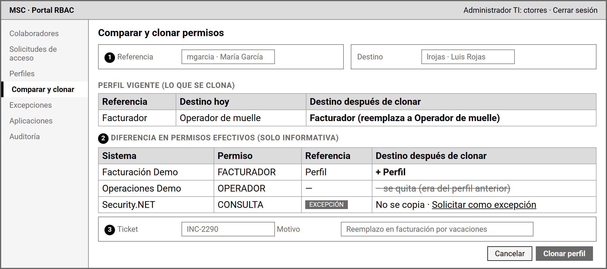
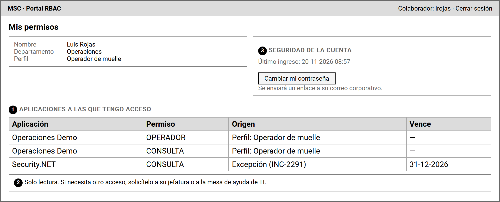
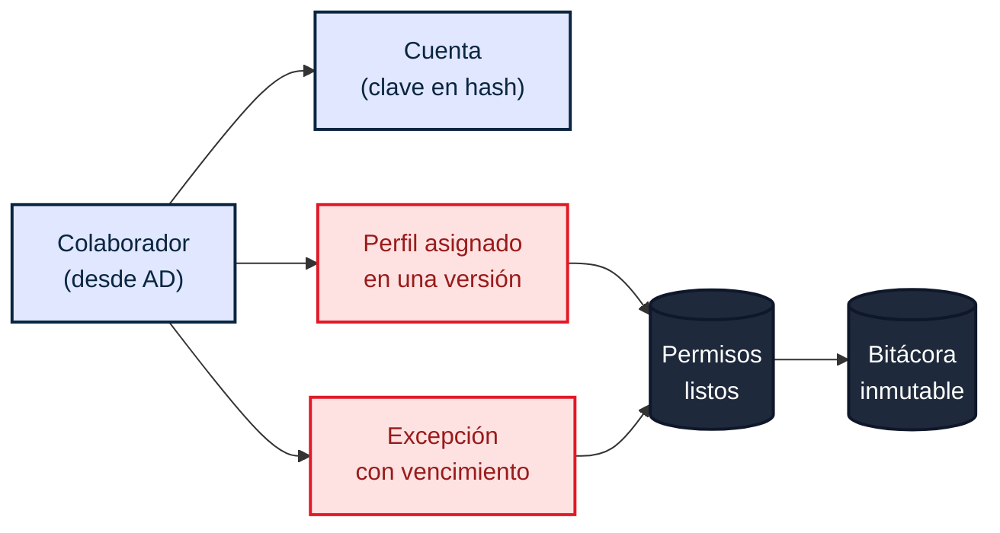

  
Proyecto Integrado · TIHV43 · Evaluación 2

  
    

    Grupo G07 · MSC-01
  

# Diseño de la Solución RBAC MSC Chile

De lo que el cliente necesita a un sistema que se puede construir

  

    
19

    
Historias de usuario

  

  

    
4

    
Hitos hasta la EVA 3

  

  

    
8

    
Pantallas diseñadas

  

  

    
51

    
Casos de prueba

  

  

    

Equipo

    
Pablo Herrera · Jesús Rincón · Sabrina Silva Abraham Tapia · Catalina Cubillos · José Morales

  

  

    

Datos académicos

    
<b>Asignatura:</b> Proyecto Integrado (TIHV43) <b>Docente:</b> Profesor Edgar López · <b>Fecha:</b> 17-11-2026

  

<!--
Guion (apertura, quien abre la presentación):
"Buenos días, profesor. En la EVA 1 diagnosticamos el problema del sistema de permisos de MSC Chile. Hoy venimos a mostrar cómo lo vamos a resolver: el diseño completo de la solución. Lo organizamos en seis bloques: contexto, plan de trabajo, arquitectura, pantallas, datos, y seguridad con pruebas. Todo lo que van a ver se puede rastrear hasta una necesidad del cliente."
-->

---

  
Bloque 1 · Contexto y alcance

  
 Entrevista 14-11

#  El problema y lo que aprendimos del cliente

  

 Hoy

  <ul class="text-xs leading-relaxed text-ink/85 space-y-1.5">
    <li>Los permisos se asignan <b>uno por uno</b>, aplicación por aplicación.</li>
    <li>Para copiar los permisos de un compañero se abren <b>dos ventanas</b> y se compara a ojo.</li>
    <li>Las contraseñas se pueden <b>ver en pantalla</b> y suelen ser «nombre.apellido».</li>
    <li>Las <b>37 aplicaciones</b> consultan los permisos a la base de datos y la sobrecargan.</li>
  </ul>

  

 Lo que cambió tras la entrevista

  <ul class="text-xs leading-relaxed text-ink/85 space-y-1.5">
    <li><b>Login propio</b> con usuario y contraseña, sin depender de Microsoft.</li>
    <li>Cada colaborador puede <b>ver sus propios permisos</b>.</li>
    <li>Un cambio de perfil se aplica a <b>todos o solo a algunos</b>.</li>
    <li>Quien sale de la empresa pierde el acceso <b>en 10 minutos o menos</b>.</li>
    <li>Corre en <b>varios servidores</b>, así que cuidamos lo que pasa si dos personas actúan a la vez.</li>
  </ul>

 Todo cambio respecto de la EVA 1 está declarado y justificado en la sección 1.4 del informe.

<!--
Guion (Bloque 1):
"El problema sigue siendo el mismo de la EVA 1: los permisos se asignan a mano, uno por uno, y para copiar los accesos de un compañero el soporte abre dos ventanas y compara casilla por casilla. Además, al revisar el sistema actual vimos que las contraseñas se ven en pantalla.
Después conversamos de nuevo con el cliente y eso cambió cinco cosas del diseño, que aparecen a la derecha. La más importante: el login ahora es propio y cada persona puede ver sus permisos. Ninguno de estos cambios recorta el alcance aprobado; todos están declarados en el informe."
-->

---

  
Bloque 1 · Contexto y alcance

  
 MVP

#  El MVP en una frase

  «Un portal donde TI aprueba accesos, asigna perfiles en vez de permisos sueltos, copia los perfiles de una persona a otra en una sola pantalla y gestiona excepciones aprobadas por otro administrador; cada colaborador ve sus permisos, y todo queda registrado sin romper las 37 aplicaciones.»

  

    

 Entra al MVP (EVA 3)

    <ul class="leading-relaxed text-ink/85 space-y-1">
      <li>Login, solicitud de acceso y contraseñas</li>
      <li>Perfiles, clonación y excepciones</li>
      <li>«Mis permisos» del colaborador</li>
      <li>Bitácora y conexión con las 37 apps</li>
    </ul>
  

  

    

 Después (EVA 4)

    <ul class="leading-relaxed text-ink/85 space-y-1">
      <li>Catálogo de aplicaciones</li>
      <li>Catálogo de departamentos</li>
      <li>Revisión periódica de accesos</li>
    </ul>
    
Diseñadas completas; solo se construyen después.

  

  

    

 No lo haremos

    <ul class="leading-relaxed text-ink/85 space-y-1">
      <li>Modificar las 37 aplicaciones</li>
      <li>Versión para celulares</li>
      <li>Login con cuenta Microsoft</li>
      <li>Conexión automática con RRHH</li>
    </ul>
  

<!--
Guion (Bloque 1):
"El MVP, que es lo que vamos a construir para la EVA 3, cabe en una frase: un portal donde TI aprueba accesos, asigna perfiles en vez de permisos sueltos, copia los perfiles de una persona a otra en una sola pantalla y gestiona excepciones; y donde cada colaborador ve sus permisos.
A la izquierda está lo que entra. Al centro, tres funciones que ya están diseñadas pero que construiremos después, porque ninguna bloquea a las demás. A la derecha, lo que dejamos fuera a propósito: por ejemplo, no vamos a tocar las 37 aplicaciones, porque es un riesgo operativo que el cliente no acepta."
-->

---

  
Bloque 2 · Planificación y equipo

  
 Cronograma

#  Plan de trabajo: 4 hitos hasta la EVA 3

  

    
H1 · Sprint 1

    
Acceso y cuentas

    
Login, solicitar y aprobar acceso, contraseña por correo y bajas automáticas.

    
<b>Se cierra cuando:</b> alguien pide acceso, otro lo aprueba y la persona entra.

  

  

    
H2 · Sprint 2

    
Permisos y perfiles

    
Perfiles, asignarlos, copiarlos, excepciones y bajas.

    
<b>Se cierra cuando:</b> un cambio de perfil afecta solo a quienes se eligieron.

  

  

    
H3 · Sprint 3

    
Vista personal y compatibilidad

    
«Mis permisos» y respuesta idéntica a las 37 aplicaciones.

    
<b>Se cierra cuando:</b> las apps reciben lo mismo que con el sistema actual.

  

  

    
H4 · Sprint 3

    
Registro, seguridad y rendimiento

    
Bitácora, permisos validados en el servidor y prueba de carga.

    
<b>Se cierra cuando:</b> nadie puede borrar la bitácora y la carga se cumple.

  

  

<b>28 tareas</b> con responsable, dependencias y sprint

  

Sprints de <b>2 semanas</b> con revisión del profesor

  

<b>«Terminado»</b> = revisado por otro, probado y sin claves en el código

<!--
Guion (Bloque 2):
"Siguiendo su indicación, organizamos el trabajo en cuatro hitos, uno por cada grupo de requisitos más importante. Primero el acceso y las cuentas, porque sin cuentas nada más funciona. Después los permisos y perfiles, que es el corazón del problema. En el tercer sprint, la vista personal, la compatibilidad con las 37 aplicaciones, la bitácora y la prueba de carga.
Cada hito tiene una prueba de cierre concreta. En el informe están las 28 tareas, con su responsable, de qué depende cada una y en qué sprint va. Una tarea solo está terminada si la revisó otro integrante, tiene sus pruebas y no deja contraseñas en el código."
-->

---

  
Bloque 2 · Planificación y equipo

  
 Roles y estándares

#  Cómo trabajamos: roles y reglas del equipo

  
<b class="text-brand-red-dark">Arquitectura y Backend</b>
Estructura del sistema y reglas de negocio.

  
<b class="text-brand-red-dark">Frontend y UI/UX (2 personas)</b>
Las 8 pantallas y su facilidad de uso.

  
<b class="text-brand-navy-dark">Base de Datos y Rendimiento</b>
Modelo de datos, velocidad y prueba de carga.

  
<b class="text-brand-navy-dark">Requerimientos y Trazabilidad</b>
Que todo responda a una necesidad.

  
<b class="text-brand-crimson">Ciberseguridad</b>
Contraseñas, roles y bitácora.

  
<b class="text-brand-crimson">Scrum, DevOps y QA</b>
Ritmo del equipo, pipeline y pruebas.

  

 Estándares que aplicamos (Git y código)

  

    

Una rama corta por tarea; nadie sube directo a la rama principal.

    

Todo cambio lo revisa <b>otro integrante</b> antes de unirse.

    

El pipeline bloquea pruebas fallidas y contraseñas escritas en el código.

    

Mensajes de commit estándar y convenciones de C#, TypeScript y SQL.

  

<!--
Guion (Bloque 2):
"Usted nos aclaró que los roles y perfiles de esta evaluación son los nuestros como equipo. Mantuvimos los seis roles de la EVA 1, con un ajuste: el frontend ahora lo llevan dos personas, porque pasamos de cinco a ocho pantallas.
Abajo están las reglas que aplicamos en el código. La principal: nadie, ni siquiera quien administra el repositorio, puede subir un cambio sin que otro integrante lo revise. Es la misma idea de separación de funciones que el sistema aplica a sus usuarios."
-->

---

  
Bloque 3 · Arquitectura e infraestructura

  
 Modelo 4+1

#  Arquitectura: una aplicación ordenada

  

  
<b class="text-brand-red-dark">¿Por qué una sola aplicación?</b> Es lo que un equipo de 6 puede construir, probar y defender en un semestre. Microservicios fue descartado.

  
<b class="text-brand-navy-dark">La regla del cliente</b> «La pregunta y la respuesta siguen siendo las mismas»: cambia el canal (ahora un endpoint REST), no lo que reciben.

  
<b class="text-brand-crimson">Modelo 4+1</b> Qué hace (lógica) · cómo se organiza el código (desarrollo) · qué pasa en ejecución (procesos) · dónde corre (física) + escenarios.

<!--
Guion (Bloque 3):
"La arquitectura la describimos con el modelo 4+1. En simple: una sola aplicación central, ordenada por módulos, que atiende tanto a TI como a los colaboradores. Elegimos una sola aplicación y no microservicios porque es lo que un equipo de seis puede construir y probar en un semestre.
La clave está en esto: hoy la base de datos calcula los permisos cada vez que una aplicación pregunta. Nosotros los calculamos solo cuando algo cambia y dejamos la respuesta lista. Así cumplimos lo que pidió el cliente: la pregunta y la respuesta siguen siendo las mismas, pero la base deja de sobrecargarse."
-->

---

  
Bloque 3 · Arquitectura e infraestructura

  
 Vista física

#  Dónde corre la solución

  

  
<b class="text-brand-red-dark">Varios servidores IIS con balanceo</b> Si uno se cae, el otro sigue atendiendo y nadie pierde su sesión.

  
<b class="text-brand-navy-dark">Los datos se quedan en MSC</b> En el SQL Server que ya usan; Redis solo guarda copias rápidas.

  
<b class="text-brand-crimson">Sin contraseñas en el código</b> No hay acceso a Key Vault, así que la base se conecta con una cuenta de servicio de Windows que nadie conoce.

  
<b>Metas medibles</b> Disponibilidad y tiempos de recuperación definidos, en vez de «cero caídas».

<!--
Guion (Bloque 3):
"Esta es la vista física, basada en lo que nos contó el cliente: la aplicación corre en varios servidores IIS con balanceo de carga. Si uno se cae, el balanceador manda todo al otro, y la sesión sigue funcionando porque las llaves de la sesión se comparten entre servidores.
Los datos se quedan en el SQL Server de MSC. Como no podemos usar Key Vault, la aplicación se conecta a la base con una cuenta de servicio de Windows, así que no hay ninguna contraseña de la base escrita en ninguna parte. Y en vez de prometer cero caídas, como en la EVA 1, definimos metas que se pueden medir."
-->

---

  
Bloque 3 · Arquitectura e infraestructura

  
 Caso borde · Concurrencia

#  ¿Qué pasa si dos administradores cambian al mismo usuario a la vez?

  

  
<b class="text-brand-red-dark">Qué pasa</b> La base deja pasar al primero; el segundo recibe «otro lo modificó, recargue» (409).

  
<b class="text-brand-navy-dark">Por qué así</b> Evaluamos la cola en Redis que nos sugirió el docente, pero elegimos el bloqueo de fila porque agrega menos piezas.

<!--
Guion (Bloque 3):
"Usted nos pidió enfocar los escenarios del 4+1 en los casos borde. El más delicado es el que nos planteó: dos administradores que, al mismo tiempo, dan y quitan el mismo permiso desde servidores distintos. Lo resolvemos en la base de datos, que es el único punto común: la base bloquea a esa persona mientras dura el primer cambio, y el segundo administrador recibe un aviso para recargar. Evaluamos la cola en Redis que nos sugirió, pero elegimos el bloqueo de fila porque agrega menos piezas."
-->

---

  
Bloque 3 · Arquitectura e infraestructura

  
 Caso borde · Redis caído

#  ¿Qué pasa si se cae Redis?

  

  <b class="text-brand-navy-dark">Qué pasa</b> La API espera como máximo 50&nbsp;ms, responde desde SQL Server y emite una alerta a operación: un poco más lento, pero sin errores para el satélite.

<!--
Guion (Bloque 3):
"También cubrimos qué pasa si se cae Redis: la API no se queda esperando, espera máximo 50 milisegundos, lee la respuesta directo de SQL Server y avisa a operación. El satélite nunca ve un error, solo una respuesta un poco más lenta."
-->

---

  
Bloque 3 · Arquitectura e infraestructura

  
 Caso borde · Desvinculación

#  ¿Qué pasa si despiden a alguien, o el directorio falla?

  

  
<b class="text-brand-crimson">Despiden a alguien</b> En la siguiente sincronización (máximo 10 minutos) pierde todo acceso, sin que nadie tenga que avisarlo.

  
<b>Lista vacía o anómala</b> Se activa el freno: no se desactiva a nadie y se avisa a TI. 15 casos borde documentados en total, cada uno con su prueba.

<!--
Guion (Bloque 3, cierre de escenarios):
"También cubrimos qué pasa si despiden a alguien o si el directorio manda una lista vacía por error. En la siguiente sincronización, máximo 10 minutos, la persona pierde todo acceso sin que nadie tenga que avisarlo. Y si la lista llega vacía o con muchas menos personas, se activa un freno: no se desactiva a nadie y se avisa a TI, para no confundir una falla del directorio con una ola de despidos. En total documentamos 15 casos borde, cada uno con su prueba."
-->

---

  
Bloque 4 · Interfaces

  
 Flujo de acceso

#  Cómo entra una persona al sistema

  

<b>1. Solicita</b>
Solo si existe en el directorio

  

<b>2. Otro aprueba</b>
Y le asigna su perfil

  

<b>3. Llega un enlace</b>
De un solo uso, 15 min

  

<b>4. Crea su clave</b>
TI nunca la conoce

  

<b>5. Entra</b>
Según su rol

  

  

    
<b class="text-brand-red-dark">Errores claros, sin dar pistas</b> «Usuario o contraseña incorrectos», sin decir cuál falló.

    
<b class="text-brand-navy-dark">Freno a la fuerza bruta</b> 5 intentos fallidos bloquean la cuenta 15 minutos.

    
<b class="text-brand-crimson">Enlace vencido</b> Se puede pedir otro sin volver a aprobar.

  

<!--
Guion (Bloque 4):
"Las pantallas las diseñamos a partir de las tareas reales. Esta es la entrada al sistema. La persona pide acceso, pero solo si ya existe en el directorio de la empresa. Un administrador distinto de quien creó la solicitud la aprueba y le asigna su perfil en el mismo paso. Le llega un enlace que sirve una sola vez y vence a los 15 minutos, como recomienda OWASP; crea su propia contraseña, y entra a la parte que le corresponde según su rol.
Así resolvemos lo que el cliente no quería repetir: la contraseña ya no se ve, ya no es nombre.apellido, y nadie de TI la conoce."
-->

---

  
Bloque 4 · Interfaces

  
 8 pantallas

#  Las pantallas que resuelven el problema

  

    

 Comparar y clonar · adiós a la «doble ventana»

    
  

  

    

 Mis permisos · lo nuevo que pidió el cliente

    
  

  <b class="text-brand-navy-dark">Las 8:</b>
  LoginMis permisosSolicitudes de accesoFicha del colaboradorComparar y clonarExcepcionesPlantilla de perfilBitácora
  · Cada una con su requisito, validaciones y 16 mensajes de error definidos.

<!--
Guion (Bloque 4):
"Diseñamos ocho pantallas. Destacamos dos. A la izquierda, comparar y clonar: reemplaza la doble ventana. Se eligen dos personas, se ven las diferencias lado a lado y se copian los perfiles con un clic, pidiendo motivo y ticket.
A la derecha, Mis permisos, el requisito nuevo que usted nos pidió: cada colaborador ve a qué aplicaciones tiene acceso y de dónde viene cada permiso. Es solo de lectura.
Cada pantalla indica qué requisito cubre, qué valida y qué mensaje muestra si algo falla. Ocultar un botón es solo una ayuda: todo se vuelve a verificar en el servidor."
-->

---

  
Bloque 5 · Datos

  
 Modelo relacional

#  Datos: qué guardamos y qué reglas cumplen

  
<b class="text-brand-red-dark">Cambio de perfil: ¿a todos o a algunos?</b> Cada cambio crea una versión nueva; TI elige a quién aplicarla.

  
<b class="text-brand-navy-dark">Clonar copia perfiles, no excepciones</b> Las excepciones son personales y requieren su propia aprobación.

  
<b class="text-brand-crimson">Nada cambia sin registro</b> El cambio y su anotación en la bitácora se guardan juntos o no se guarda nada.

  
<b>Base real</b> Partimos del sistema actual; el profesor nos enviará el esquema real para ajustar.

<!--
Guion (Bloque 5):
"El modelo de datos parte del sistema actual, donde a cada persona se le asignan los permisos de cada aplicación uno por uno. Lo que faltaba era el perfil: un paquete de permisos que se asigna de una vez. En simple: el colaborador viene del directorio, tiene una cuenta con su clave guardada de forma irreversible, tiene perfiles y, si corresponde, excepciones con fecha de término. De ahí se calcula la lista de permisos lista para entregar.
Hay tres reglas importantes. Cuando se cambia un perfil se crea una versión nueva, y TI decide si aplicarla a todos o solo a algunos, como acordamos con el cliente. Al clonar se copian los perfiles, no las excepciones. Y nada cambia sin quedar registrado. En el informe están el diagrama completo, el diccionario de datos y diez reglas de integridad."
-->

---

  
Bloque 5 · Datos

  
 Modelo no relacional

#  ¿Por qué también Redis?

  

    

 SQL Server (relacional)

    <ul class="space-y-1.5 text-ink/85 leading-relaxed">
      <li><b>Fuente de verdad:</b> todo lo oficial vive aquí.</li>
      <li>Reglas, relaciones e historial completo.</li>
      <li>Responde las consultas de siempre de las 37 apps.</li>
    </ul>
  

  

    

 Redis (no relacional)

    <ul class="space-y-1.5 text-ink/85 leading-relaxed">
      <li>Guarda <b>una ficha lista por persona</b> con sus permisos.</li>
      <li>Se lee de memoria, sin buscar ni cruzar tablas.</li>
      <li>Si se borra o se cae, <b>no se pierde nada</b>: se rehace desde SQL.</li>
    </ul>
  

  

~300

usuarios en hora punta

  

~600

consultas simultáneas a la API

  

10 min

duración máxima de cada ficha

<!--
Guion (Bloque 5):
"Usamos dos tipos de almacenamiento y cada uno tiene un motivo. SQL Server es la fuente de verdad: ahí están las reglas, las relaciones y el historial. Redis guarda una ficha por persona con sus permisos ya resueltos, lista para entregarla.
¿Por qué no guardar eso también en SQL? Porque las aplicaciones siempre hacen la misma pregunta, qué permisos tiene esta persona, y Redis la responde desde memoria, sin cruzar tablas. Según el cliente, en hora punta hay unas 600 consultas al mismo tiempo, y las mismas personas se consultan muchas veces. Si Redis se cae, no perdemos nada, porque todo se rehace desde SQL."
-->

---

  
Bloque 6 · Seguridad, pruebas y trazabilidad

  
 Seguridad

#  Seguridad: quién puede hacer qué

  

    
<b class="text-brand-red-dark">Administrador TI</b> Gestiona accesos, perfiles y excepciones.

    
<b class="text-brand-navy-dark">Colaborador</b> Ve sus permisos. Incluye a los pasantes de TI.

  

  

    

 Matriz de permisos

    <table class="w-full text-xs">
      <thead><tr><th class="text-left">Acción</th><th class="whitespace-nowrap">Admin. TI</th><th>Colaborador</th></tr></thead>
      <tbody>
        <tr><td>Ver sus propios permisos</td><td class="text-center">✓</td><td class="text-center">✓</td></tr>
        <tr><td>Ver permisos de otras personas</td><td class="text-center">✓</td><td class="text-center">✗</td></tr>
        <tr><td>Asignar perfiles, clonar, dar de baja</td><td class="text-center">✓ ²</td><td class="text-center">✗</td></tr>
        <tr><td>Solicitar y aprobar excepciones</td><td class="text-center">✓ ¹ ²</td><td class="text-center">✗</td></tr>
        <tr><td>Consultar la bitácora</td><td class="text-center">✓</td><td class="text-center">✗</td></tr>
        <tr><td>Modificar o borrar la bitácora</td><td class="text-center">✗</td><td class="text-center">✗</td></tr>
      </tbody>
    </table>
    
¹ No aprueba lo que él creó · ² Nunca sobre sí mismo · Lo demás está denegado.

  

  

    

 Contraseñas: antes y ahora

    <table class="w-full text-xs">
      <thead><tr><th class="text-left">Sistema actual</th><th class="text-left">Nuevo diseño</th></tr></thead>
      <tbody>
        <tr><td>Se puede ver en pantalla</td><td>Nadie la ve, ni TI</td></tr>
        <tr><td>Guardada de forma reversible</td><td>Hash irreversible</td></tr>
        <tr><td>Suele ser «nombre.apellido»</td><td>Mínimo 12 caracteres</td></tr>
        <tr><td>Sin límite de intentos</td><td>Bloqueo tras 5 intentos</td></tr>
        <tr><td>La entrega TI</td><td>La crea la persona con un enlace</td></tr>
      </tbody>
    </table>
  

  

    <b class="text-brand-crimson">Ocultar un botón no basta</b>
    
Cada acción se vuelve a verificar en el servidor.

  

<!--
Guion (Bloque 6):
"El portal tiene dos roles para personas, los que definió el cliente: el Administrador TI, que gestiona los accesos, y el Colaborador, que solo ve sus permisos; los pasantes de TI quedan como colaboradores.
En la matriz se ve qué puede hacer cada uno. Todo lo que no aparece está denegado. La separación de funciones que nos pidió en el feedback está en las notas de la tabla: nadie aprueba lo que él mismo creó y nadie se modifica a sí mismo. Por eso el sistema necesita al menos dos administradores. Y ocultar un botón es solo una ayuda: cada acción se vuelve a verificar en el servidor.
A la derecha, el cambio más visible: las contraseñas. Hoy se ven y se pueden revertir. En el nuevo diseño nadie las ve, se guardan de forma irreversible y la persona crea la suya con un enlace."
-->

---

  
Bloque 6 · Seguridad, pruebas y trazabilidad

  
 Plan de pruebas

#  Cómo sabremos que funciona

  

23

casos de que <b>funciona</b>

  

12

casos de que <b>rechaza</b> lo incorrecto

  

16

casos de <b>seguridad</b>

  

4

escenarios de <b>carga</b>, hasta 600 consultas simultáneas

  

    
Ejemplo · CP-06 · RF-12: despido

    
<b>Dado</b> un colaborador con permisos, <b>cuando</b> desaparece del directorio, <b>entonces</b> en 10 minutos o menos queda sin acceso, las 37 apps no reciben sus permisos y queda registrado.

  

  

    
Ejemplo · CP-34 · RF-11 y RF-15: aprobarse a sí mismo

    
<b>Dado</b> un administrador que creó una solicitud, <b>cuando</b> intenta aprobarla, <b>entonces</b> el sistema la rechaza, sigue pendiente y el intento queda registrado.

  

 Cada requisito tiene al menos una prueba con resultado observable. Los resultados se presentan en la EVA 3.

<!--
Guion (Bloque 6):
"El plan tiene 51 casos de prueba: 23 que verifican que cada función hace lo que promete, 12 que verifican que el sistema rechaza lo incorrecto sin cambiar nada, y 16 de seguridad. Además hay cuatro escenarios de carga: según el cliente, en hora punta unos 300 usuarios generan unas 600 consultas simultáneas, y la prueba sube por escalones hasta ese nivel.
Cada caso tiene un resultado que se puede comprobar sin interpretación. Y cada caso está vinculado a un requisito. Por ejemplo, el CP-06 prueba el RF-12: si una persona desaparece del directorio, en 10 minutos o menos debe quedar sin acceso. El CP-34 prueba la separación de funciones: si un administrador intenta aprobar su propia solicitud, el sistema la rechaza. Todo requisito tiene al menos una prueba, y los resultados los mostraremos en la EVA 3."
-->

---

  
Bloque 6 · Seguridad, pruebas y trazabilidad

  
 Trazabilidad

#  Todo se conecta con una necesidad

  
<b>Necesidad</b>
N-10 · ver mis permisos

  
<b>Historia</b>
HU14

  
<b>Requisito</b>
RF-14

  
<b>Pantalla</b>
Mis permisos

  
<b>Dato</b>
Permisos listos

  
<b>Seguridad</b>
Solo lo propio

  
<b>Prueba</b>
CP-15, CP-37

  

    

 Próximo paso: Sprint 1

    
Construir el hito 1, acceso y cuentas. La demostración será pedir acceso, aprobarlo con otro administrador, crear la clave y entrar.

  

  

    

 Pendientes declarados

    <ul class="text-ink/85 space-y-0.5">
      <li>Tiempos actuales de alta, cambio y baja (línea base).</li>
      <li>Entrevista con RRHH.</li>
      <li>Esquema real de la base de datos.</li>
    </ul>
  

<!--
Guion (Bloque 6, cierre):
"Para cerrar: cada elemento del diseño se puede seguir desde una necesidad hasta una prueba. Por ejemplo, la necesidad de que cada persona vea sus permisos se convierte en la historia 14 y el requisito 14, se resuelve en la pantalla Mis permisos, usa la lista de permisos ya calculada, solo muestra lo propio y se verifica con dos pruebas. En el informe está la matriz completa para todos los requisitos.
Lo siguiente es el sprint 1, el acceso y las cuentas. Y somos transparentes con lo pendiente: los tiempos actuales de cada operación, la entrevista con RRHH y el esquema real de la base."
-->

---
layout: end
transition: fade
---

Proyecto Integrado · TIHV43 · Evaluación 2

# ¡Muchas Gracias!

Diseño de la solución · RBAC MSC Chile

  <b>Docente:</b> Profesor Edgar López &nbsp;·&nbsp; <b>Grupo:</b> G07 &nbsp;·&nbsp; <b>Fecha:</b> 17-11-2026

  
 Quedamos atentos a sus preguntas

<!--
Guion (cierre):
"Muchas gracias, profesor. Quedamos atentos a sus preguntas; cualquiera de nosotros puede responder sobre cualquier parte del diseño."
-->
